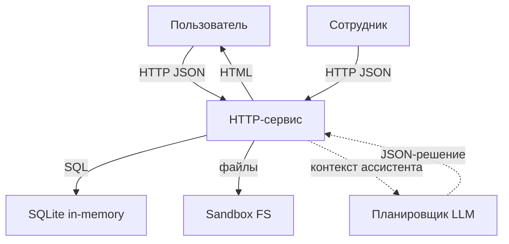

# Модель угроз Mini Shop

Кратко: локальный учебный сервис с HTTP API, БД SQLite (в памяти) и песочницей файлов. Роли: клиент (customer), сотрудник (staff), и внешний планировщик/ассистент (LLM), чьи решения исполняет сервер ограниченными инструментами.

Состав:
- HTTP-сервис (ThreadingHTTPServer, endpoint'ы из service.py)
- БД SQLite (таблицы profiles, orders)
- Песочница файлов (sandbox.py) с чеками пользователей и служебной заметкой
- Отзывы (in-memory), формирующие HTML-страницу
- Ассистент: выдаёт контекст, принимает решение и выполняет одно из средств: read_file, export_profiles, delete_tree

Ценности (assets):
- Персональные профили (имя, email, адрес)
- Чеки пользователей (files/<user>/receipt.txt)
- Служебная заметка (private/operator-note.txt)
- Токены сессий
- Журналы запросов (могут содержать токены и тела)

Границы доверия (trust boundaries):
- Клиент ↔ HTTP-сервер (недоверенные входы, требуется аутентификация и авторизация)
- Сервер ↔ ассистент (планировщик LLM) — решения считаются недоверенными, даже если они выглядят корректно
- Сервер ↔ файловая песочница — недопустимо выходить за пределы root песочницы, доступ должен быть scope'нут по пользователю
- Роль staff против customer — операции staff не должны навязываться клиентом

Потоки данных (DFD):

Угрозы по STRIDE и связь с эндпоинтами:

Spoofing (подмена):
- Клиент мог подменить роль через заголовок X-Role для /admin/export. Исправлено: роль берётся из сессии.
- Утечка токена через /debug/logs могла позволить захват сессии. Исправлено: доступ к логам только для staff.

Tampering (подмена данных):
- POST /orders принимал произвольную цену из клиента. Исправлено: цена всегда из каталога.
- Инструмент delete_tree мог удалять любые пути в песочнице. Исправлено: разрешено удаление только файлового поддерева пользователя.

Repudiation (отрицание действий):
- Логи запросов велись, но были доступны всем. Теперь доступны только staff. Дополнительно можно рассмотреть подписанные аудиты/корреляцию по токену.

Information Disclosure (раскрытие информации):
- SQL-инъекции в /profile и /search давали доступ к чужим данным. Исправлено: параметризованные запросы и игнорирование query id для профиля (только свой).
- /files позволял читать чужие чеки и служебную заметку. Исправлено: всегда возвращает только собственный чек.
- /reviews/view уязвим для XSS. Исправлено: экранирование HTML.
- Инструмент export_profiles раньше был доступен клиенту. Исправлено: только для staff.

Denial of Service (отказ в обслуживании):
- delete_tree с path:"." мог уничтожать все учебные файлы. Исправлено ограничением области.
- Ограничение Content-Length уже присутствует (≤ 65536). Дополнительно можно добавить rate limiting.

Elevation of Privilege (эскалация привилегий):
- Подмена X-Role и инструменты ассистента позволяли выполнять операции staff. Исправлено проверкой роли из сессии и ограничением инструментов.

Реализованные меры (итог):
- Централизация аутентификации/авторизации по токену, роль не берётся из заголовков клиента.
- Параметризованные SQL-запросы, жесткая привязка профиля/заказов к владельцу.
- Жёсткая политика файлов: только собственный чек; ассистент может читать/удалять только свои файлы.
- XSS-митигация через экранирование отзывов.
- Ограничение доступа к логам.
- Игнорирование клиентской цены — только цены каталога.

Остаточные риски и рекомендации:
- Нет rate limiting и блокировок при переборе пароля.
- Нет MFA и ограничений срока жизни токена.
- Логи содержат тела запросов; возможна утечка чувствительных данных внутри staff-зоны — рассмотреть маскирование.
- Для ассистента: включить явные проверки схемы JSON-решения и аудит отклонённых инструментов.
